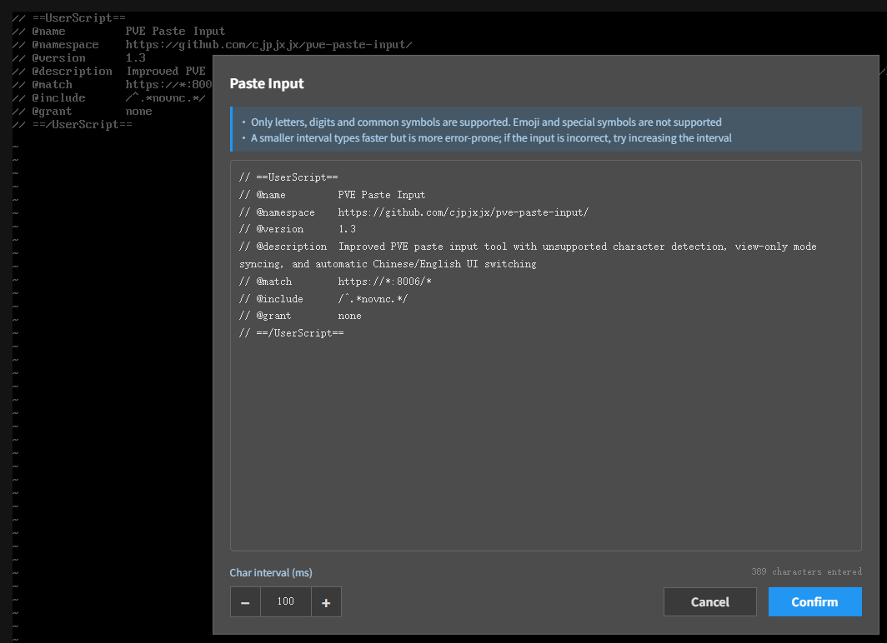

# PVE Paste Input Tool

[中文](README.md) | English

A text paste-and-type tool for the Proxmox VE noVNC console, letting you quickly type large blocks of text into a virtual machine.

> **Common issue:** if the console's CapsLock state gets out of sync, see [Fixing CapsLock/NumLock Desync in the PVE Console](pve-capslock-sync.en.md)

## Screenshot



## How It Works

### Core Mechanism

The tool types text into the VM one character at a time, choosing between two paths:

1. Primary: send each character directly through the noVNC client's own key-sending interface, passing the keysym and physical key `code`
2. Fallback: when that interface is not reachable, dispatch synthesized `keydown` and `keyup` events to the console canvas element

Both paths hold the Shift key around uppercase letters and symbols that need it, and reset modifier key states before and after typing to avoid stuck keys.

### Key Technical Details

- Adjustable inter-character delay (default 50 ms, no upper limit); the last-used value is remembered
- Supports newline (`\n`), tab (`\t`), and common symbols
- Detects unsupported non-ASCII characters (Chinese, emoji, etc.) in real time

### UI Interaction

- A modal dialog provides a text input box with a live character counter (no character limit)
- A character-interval control (minus/plus buttons with a numeric input) in the dialog footer lets you adjust the typing speed in real time; the value is remembered
- The dialog can be closed with the ESC key
- While typing is in progress, a progress overlay (characters typed / total) is shown with a semi-transparent mask that blocks page interaction; you can cancel at any time by clicking it. Attempting to close or refresh the page triggers a browser confirmation prompt
- The mask is automatically removed when typing finishes or is cancelled, and the result is shown in a toast notification
- The paste button is automatically hidden when the VM is powered off or the console is in view-only mode
- The tool's UI language automatically follows the PVE interface language (no manual switch) — see below for details

### Interface Language

The tool's UI language automatically follows the language currently set in the PVE login interface, with no manual configuration needed:

1. It first reads the browser's `PVELangCookie` (the cookie PVE uses to record the user's selected interface language)
2. If that cookie doesn't exist, or its value is neither Chinese nor English, it falls back to the browser language (`navigator.language`)
3. The result is classified into only two interfaces: Chinese or English (any other language is treated as English)

## Usage

### Option 1: Userscript (Tampermonkey/Violentmonkey)

1. Install the Tampermonkey or Violentmonkey browser extension
2. Install the script: [pve-paste.user.js](https://github.com/cjpjxjx/pve-paste-input/raw/refs/heads/main/pve-paste.user.js)
3. Open the PVE noVNC console page
4. Click the paste button (clipboard icon) in the control bar

#### Customizing the PVE Address

Default matching rules:
- `https://*:8006/*` (the standard PVE port)
- `/^.*novnc.*/` (any path containing "novnc")

To match a specific domain (e.g. `https://pve.example.com/`), edit the `@match` rule in the script header:

```javascript
// ==UserScript==
// @match        https://pve.example.com/*
// @include      /^.*novnc.*/
// ==/UserScript==
```

You can also keep multiple match rules at once:

```javascript
// ==UserScript==
// @match        https://*:8006/*
// @match        https://pve.example.com/*
// @include      /^.*novnc.*/
// ==/UserScript==
```

To edit: open the installed script in your userscript manager, click Edit, update the `@match` line(s) in the header, and save.

#### Features

- Automatically matches PVE domains and noVNC paths
- Automatically detects the Nginx-injected version to avoid loading twice

### Option 2: Nginx Injection

Suited for deployments served through a unified reverse proxy.

#### Example Configuration

Inject the script using `sub_filter` in your Nginx config:

```nginx
location / {
    proxy_pass https://pve-backend;

    # Disable compression so the response body can be modified
    proxy_set_header Accept-Encoding "";

    # Inject the script before </head>
    sub_filter '</head>' '<script src="https://raw.githubusercontent.com/cjpjxjx/pve-paste-input/refs/heads/main/pve-paste-inject.js"></script></head>';
    sub_filter_once on;
}
```

#### Features

- Automatically detects noVNC pages
- No manual extension installation required
- Applies to all users who access the proxy

## Supported Characters

- **Supported**: upper/lowercase letters, digits, common symbols, newline, tab
- **Not supported**: Chinese characters, emoji, extended Unicode characters

Character range: printable ASCII (32-126) + newline (10) + carriage return (13) + tab (9)

## Notes

1. The two loading methods should not be used together; the userscript version automatically detects and avoids conflicts
2. Unsupported characters trigger a warning, letting you choose to continue sending or cancel
3. While typing is in progress, the mask blocks page interaction; click the cancel button on the progress overlay to abort
4. Do not close or refresh the page while typing is in progress, as this may interrupt the input (the browser will show a confirmation prompt)

## Compatibility

- Browsers: Chrome, Firefox, Edge (requires ES6 support)
- PVE versions: tested on 5.x, 7.x, 8.x, and 9.x

## Files

| File | Description |
| --- | --- |
| [pve-paste.user.js](pve-paste.user.js) | Userscript version |
| [pve-paste-inject.js](pve-paste-inject.js) | Nginx injection version |

## License

Built on top of amunchet's [noVNCCopyPasteProxmox.user.js](https://gist.github.com/amunchet/4cfaf0274f3d238946f9f8f94fa9ee02).
