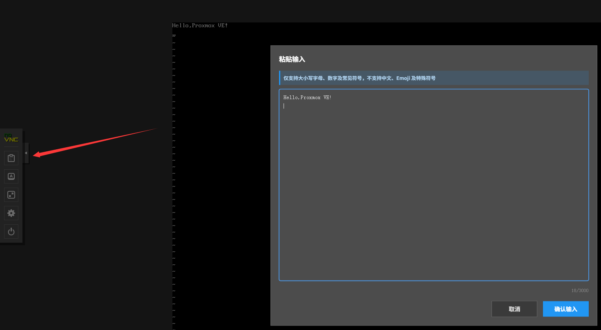

# PVE 粘贴输入工具

针对 Proxmox VE noVNC 控制台的文本粘贴输入工具，支持将大段文本快速输入到虚拟机中。

> **常见问题：** 如果遇到控制台大小写不同步的问题，请参考 [PVE 控制台大小写不同步的解决方法](pve-capslock-sync.md)

## 效果截图



## 技术原理

### 核心机制

通过模拟键盘事件（KeyboardEvent）向 noVNC Canvas 元素发送字符序列，实现文本的逐字符输入：

1. 使用 `dispatchEvent` 分发 `keydown` 和 `keyup` 事件
2. 将字符映射为对应的 `keyCode` 和 `code` 属性
3. 自动处理需要 Shift 键的大写字母和特殊符号
4. 在输入前后重置所有修饰键状态，避免状态残留

### 关键技术点

- 字符间隔 10 毫秒发送，确保 noVNC 正确接收
- 对需要 Shift 的字符，先按下 Shift，发送字符后立即释放
- 支持换行符 (`\n`)、制表符 (`\t`) 及常见符号
- 实时检测不支持的非 ASCII 字符（中文、Emoji 等）

### UI 交互

- 模态对话框提供文本输入框和实时字符统计
- 字符数限制为 3000 字符
- 支持 ESC 键关闭对话框
- 虚拟机关机或仅查看模式时自动隐藏粘贴按钮

## 使用方式

### 方式一：油猴脚本

1. 安装浏览器扩展 Tampermonkey 或 Violentmonkey
2. 安装脚本 [pve-paste.user.js](https://github.com/cjpjxjx/pve-paste-input/raw/refs/heads/main/pve-paste.user.js)
3. 访问 PVE noVNC 控制台页面
4. 点击控制栏中的粘贴按钮（剪贴板图标）

#### 自定义 PVE 地址

默认匹配规则：
- `https://*:8006/*`（标准 PVE 端口）
- `/^.*novnc.*/`（包含 novnc 的路径）

如需匹配特定域名（如 `https://pve.example.com/`），需要修改脚本头部的 `@match` 规则：

```javascript
// ==UserScript==
// @match        https://pve.example.com/*
// @include      /^.*novnc.*/
// ==/UserScript==
```

也可以同时保留多个匹配规则：

```javascript
// ==UserScript==
// @match        https://*:8006/*
// @match        https://pve.example.com/*
// @include      /^.*novnc.*/
// ==/UserScript==
```

修改方法：在油猴扩展中找到已安装的脚本，点击编辑，修改头部的 `@match` 行后保存即可。

#### 特性

- 自动匹配 PVE 域名和 noVNC 路径
- 自动检测 Nginx 注入版本，避免重复加载

### 方式二：Nginx 注入

适用于通过反向代理统一部署的场景。

#### 配置示例

在 Nginx 配置中使用 `sub_filter` 注入脚本：

```nginx
location / {
    proxy_pass https://pve-backend;

    # 禁用压缩，确保能修改内容
    proxy_set_header Accept-Encoding "";

    # 在 </head> 前注入脚本
    sub_filter '</head>' '<script src="https://raw.githubusercontent.com/cjpjxjx/pve-paste-input/refs/heads/main/pve-paste-inject.js"></script></head>';
    sub_filter_once on;
}
```

#### 特性

- 自动检测 noVNC 页面
- 无需手动安装扩展
- 对所有访问用户生效

## 支持的字符

- **支持**：大小写字母、数字、常见符号、换行符、制表符
- **不支持**：中文、Emoji、扩展 Unicode 字符

字符范围：ASCII 可打印字符（32-126）+ 换行（10）+ 回车（13）+ 制表符（9）

## 注意事项

1. 两种加载方式不能同时使用，油猴版本会自动检测并避免冲突
2. 不支持的字符会触发警告提示，可选择继续发送或取消
3. 字符数超过 3000 时无法发送，需删减内容
4. 输入过程中请勿操作虚拟机，等待输入完成

## 兼容性

- 浏览器：Chrome、Firefox、Edge（需支持 ES6）
- PVE 版本：在 5.x、7.x、8.x 版本测试通过

## 文件说明

| 文件 | 说明 |
| --- | --- |
| [pve-paste.user.js](pve-paste.user.js) | 油猴脚本版本 |
| [pve-paste-inject.js](pve-paste-inject.js) | Nginx 注入版本 |

## 许可

基于 amunchet 的 [noVNCCopyPasteProxmox.user.js](https://gist.github.com/amunchet/4cfaf0274f3d238946f9f8f94fa9ee02) 开发。